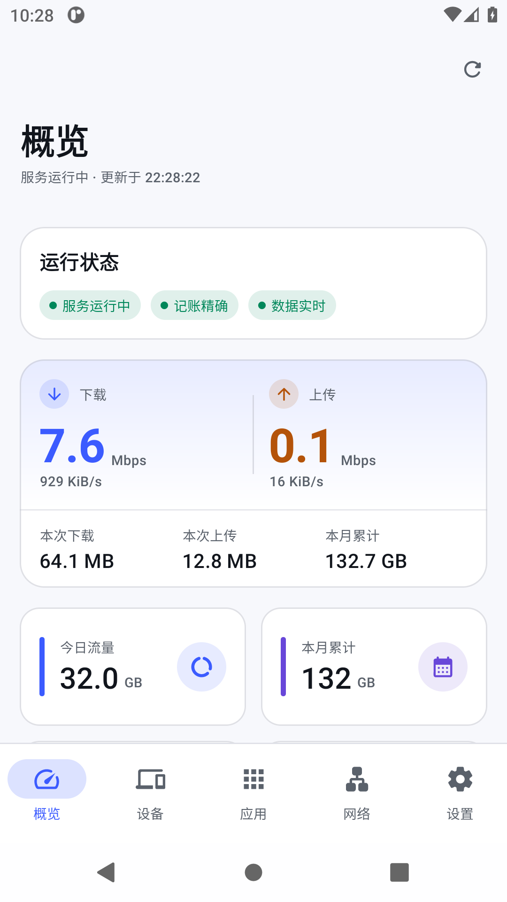
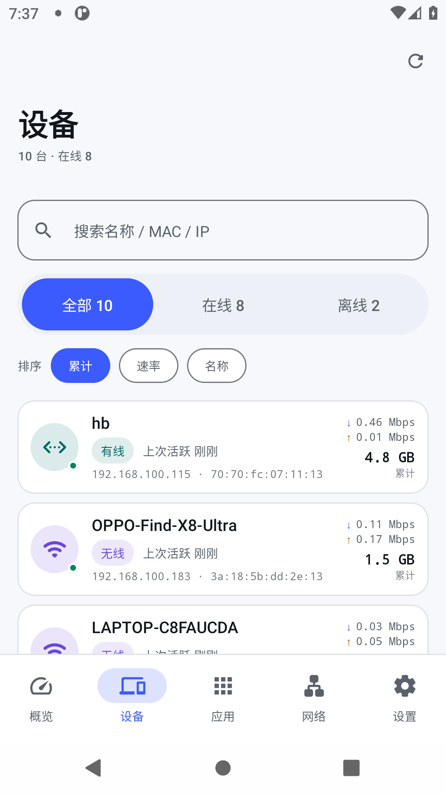
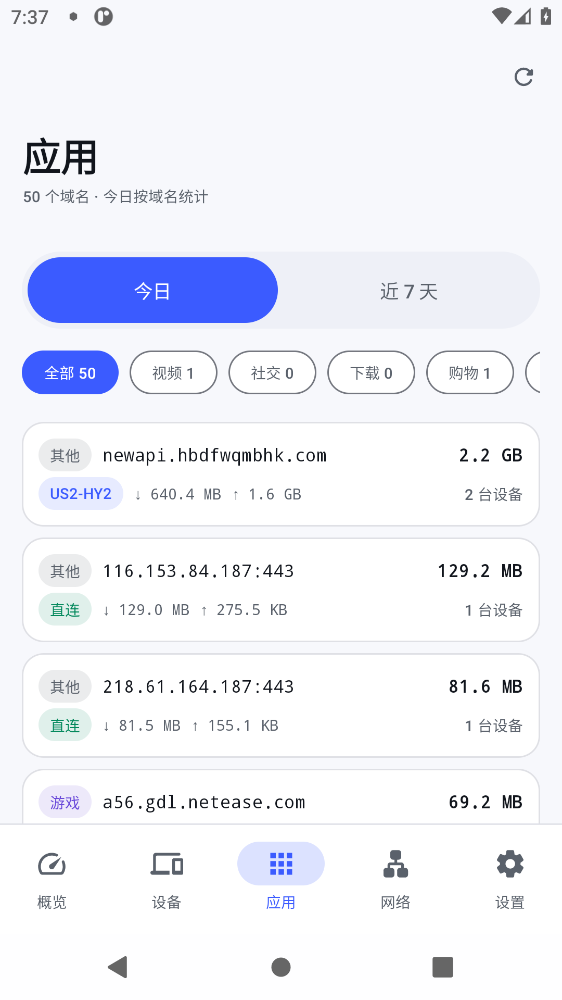
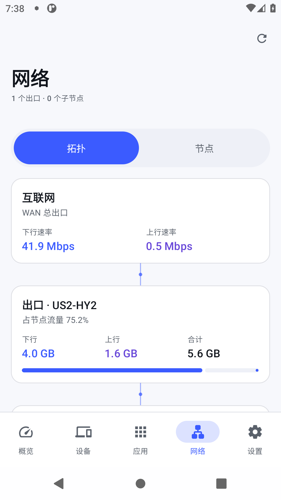
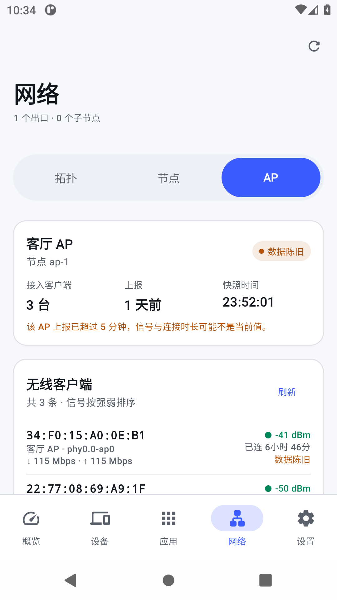
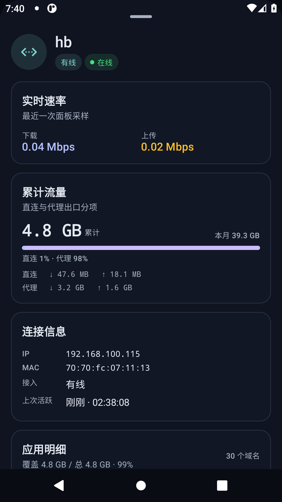
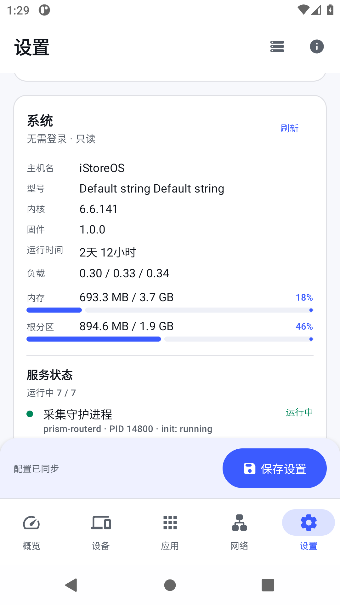
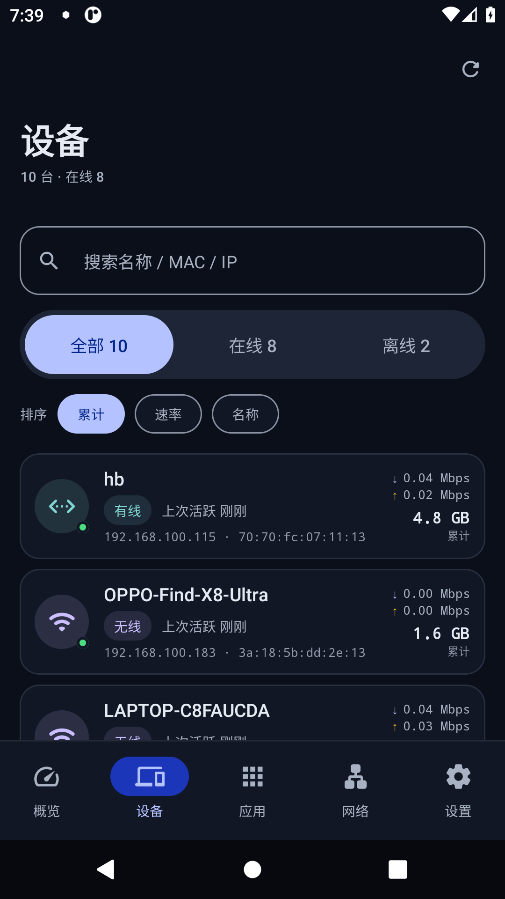
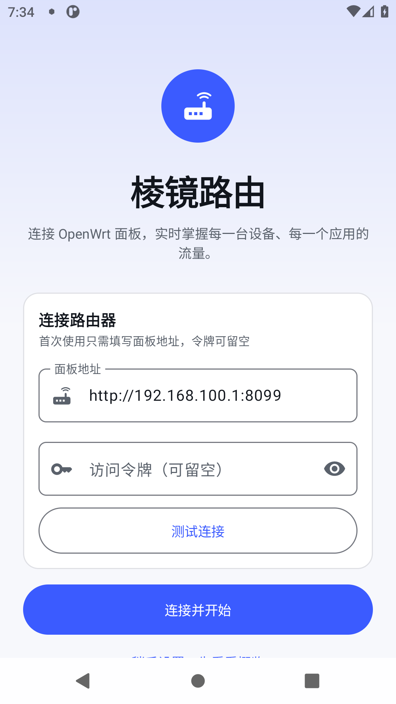
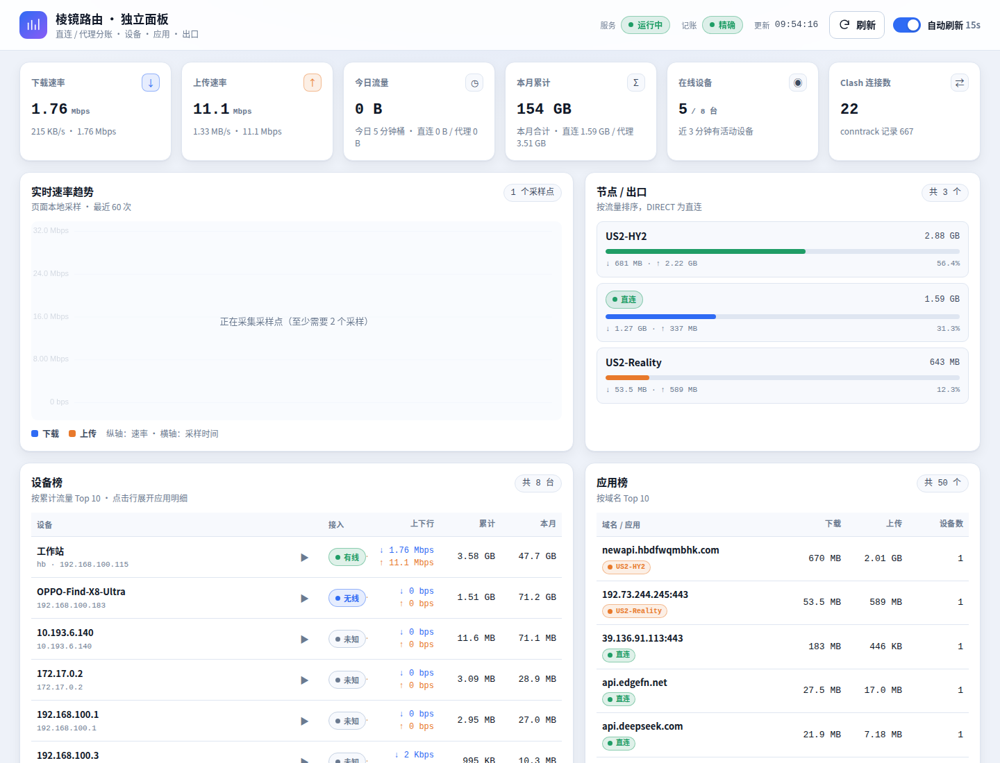

<div align="center">

# 棱镜路由 · PRISM Router

**OpenWrt / iStoreOS 流量统计与路由器控制插件**

单包安装 · LuCI 页面 + 独立面板 + Android 原生客户端 · 按设备 / 应用 / 出口细分流量

</div>



## 功能

### 流量统计

- **代理 / 直连分账**：Clash `/connections` 负责被接管流量，`nf_conntrack` 负责直连，fake-ip 段自动去重
- **按设备 / 应用 / 出口**：每台设备的上下行、累计、本月，以及该设备各应用的用量
- **时间维度**：5 分钟桶、每日 daily 文件、近 7 天趋势、应用 Top 50 归档
- **健康度**：记账可信度（精确 / 降级 / 不可用）、数据源状态、数据新鲜度、链路识别来源

### 路由器控制（可选，登录后）

- **家长控制**：按设备暂停 / 恢复上网（nftables fw4，规则可逆、重启重放）
- **网络配置**：LAN / WAN / DHCP / 系统 / 端口转发，改前自动备份、可回滚
- **系统管理**：重启、无线开关（有无线网卡时）、服务与进程状态
- **飞书**：日报 / 周报、告警、扫码绑定群、自定义机器人与应用机器人双模式

### 三种界面

| 界面 | 说明 |
|---|---|
| LuCI 插件页 | 概览 / 设备 / 应用 / 节点 / 设置 / 手机版 / 诊断 |
| 独立面板 | 单独端口（默认 8099）的只读仪表盘，可脱离 LuCI 使用 |
| Android 原生客户端 | Kotlin + Compose，概览 / 设备 / 应用 / 网络（拓扑·节点·AP）/ 设置 |

## 截图

### Android 客户端

| 概览 | 设备 | 应用 |
|---|---|---|
|  |  |  |

| 网络拓扑 | AP 面板 | 设备详情 |
|---|---|---|
|  |  |  |

| 系统信息 | 深色模式 | 首次引导 |
|---|---|---|
|  |  |  |

### 独立面板

| 桌面 | 手机 |
|---|---|
|  |  |

## 安装

### 路由器（OpenWrt 23.05+ / iStoreOS）

从 [Releases](https://github.com/hb-degithub/luci-app-prism-router/releases) 下载 `luci-app-prism-router_*_all.ipk`：

```sh
opkg install luci-app-prism-router_1.0.0-1_all.ipk
/etc/init.d/prism-routerd enable
/etc/init.d/prism-routerd restart
```

安装后在 LuCI「服务 → 棱镜路由」打开。数据写入 `/tmp/prism-router/state.json`，每日汇总在 `/etc/prism-router/daily/`。

### Android

下载 Release 中的 `prism-router-android-*.apk` 安装，打开后填写面板地址：

- 默认 `http://192.168.100.1:8099`
- 访问令牌可留空（面板未开启 token 时）

## 独立面板（可选）

默认关闭。开启后可用手机浏览器或 Android 客户端访问：

```sh
uci set prism-router.panel=panel
uci set prism-router.panel.enabled='1'
uci set prism-router.panel.port='8099'
uci commit prism-router
/etc/init.d/prism-router-panel enable
/etc/init.d/prism-router-panel start
```

## 家长控制与管理（可选）

管理写操作默认关闭，需先在路由器开启 token：

```sh
uci set prism-router.panel.token='<至少 16 位随机串>'
uci set prism-router.panel.write_enabled='1'
uci commit prism-router
/etc/init.d/prism-router-panel restart
```

然后在 App 设置里「管理员」用 **root + 管理密码** 登录，即可：
- 设备详情里暂停 / 恢复上网
- 修改 LAN / WAN / DHCP / 系统 / 端口转发（改前自动备份，支持回滚）
- 重启路由器、无线开关

## 自动更新

支持通过 GitHub Releases 检测新版本：

```sh
uci set prism-router.update.github_repo='hb-degithub/luci-app-prism-router'
uci commit prism-router
```

App「设置 → 关于 → 检查更新」会显示新版本、发布时间与 APK / IPK 下载链接。

## 构建

### 路由器插件（无需 OpenWrt SDK）

```sh
bash tools/build-ipk.sh          # 产物在 dist/
```

### Android

```sh
cd android
echo "sdk.dir=$ANDROID_HOME" > local.properties
./gradlew assembleDebug          # 或 assembleRelease（需 keystore）
```

正式签名需要 `android/keystore/prism-router.jks`（不入库）与 `android/gradle.properties` 中的 `PRISM_STORE_PASSWORD` / `PRISM_KEY_PASSWORD`。

## 自动发版

推 tag 即自动构建并发布（GitHub Actions，正式签名）：

```sh
git tag v1.0.2
git push origin v1.0.2
```

CI 会构建 `ipk` 与正式签名 `apk`，自动创建 Release 并上传附件。签名密钥通过仓库 Secrets 注入（`PRISM_KEYSTORE_BASE64` / `PRISM_STORE_PASSWORD` / `PRISM_KEY_PASSWORD`）。

## 架构

```
luci-app-prism-router/
├── root/                 运行时文件（daemon / init / CGI / 面板 / rpcd）
├── htdocs/               LuCI 页面（JS）
├── Makefile              单包构建（OpenWrt SDK）
android/                  Kotlin + Jetpack Compose 原生客户端
tools/                    手工打包、测试脚本
tests/                    容器化门禁（15 套）
docs/                     规格、审计、性能、截图
```

- 守护进程：ucode（`prism-routerd`），无第三方运行时依赖
- 数据面：Clash API + conntrack，fake-ip 去重，5 分钟桶
- 管理面：`prism-router-admin` CGI（token 保护、备份回滚、审计日志）
- 面板服务：独立 `uhttpd` 实例（默认关闭）

## 安全与隐私

- 统计功能**只读**：不改任何路由器配置
- 管理写操作：必须登录（root 密码校验）、token 30 分钟有效、失败限速
- 修改配置前自动备份（`/etc/prism-router/backup/`，保留 10 份），支持回滚
- 密码 / token 不进日志、不进 URL、不落 DataStore
- 所有数据留在本机，不上传云端

## 测试

```sh
bash tools/test-release.sh       # 15 套容器门禁
cd android && ./gradlew testDebugUnitTest
```

## 文档

- [规格说明](docs/SPEC.md)
- [打包格式](docs/IPK-FORMAT.md)
- [性能说明](docs/PERFORMANCE.md)
- [部署规则](docs/DEPLOY-RULES.md)

## 许可

GPL-2.0-only
